- Final-year B.Tech Computer Science (AI/ML) student at **VIT Bhopal**, graduating 2027
- Research focus: **multimodal deep learning architectures**, explainable AI, and sports analytics
- **Research Intern**, CHTR, RV College of Engineering (Jun - Aug 2026): deep learning for early detection of dementia and Alzheimer's disease
- **AI Engineer Intern**, Viswam AI (Jun - Jul 2025): curated training data for the first Telugu LLM built from the ground up.
- Published at **IEEE, Springer and Elsevier** venues (see Research below)
- From Visakhapatnam, India.
- Open to research collaborations.

**Core** 

**Machine Learning and Deep Learning** 

**NLP and LLMs** 

**Computer Vision** 

**Cloud** 

| Project | Stack | What it does |
|:--|:--|:--|
| **F1 Aggression Score Prediction** | Python, Transformers | TabTransformer-inspired model that estimates F1 driver aggression from track and race-condition data. **R² = 0.998, MAE = 0.79** |
| **StellaRGCN** | Python, RGCN, Deep Learning | Classifies planets, stars and quasars from astrophysical features such as redshift. **98% accuracy**, ahead of standard baselines |
| **APEX** | LLaMA 3.1, RAG, Python | Automotive and motorsport chatbot with a custom knowledge base and live retrieval. **17% faster retrieval per query** |
| **Farm Smart** | Python, Machine Learning | Low-connectivity precision agriculture platform for crop recommendation, soil-test interpretation and yield optimization. **8 languages, ~95% accuracy** |
| **Multi-Drone Forest Surveillance** | YOLOv8, Flask, Computer Vision | End-to-end monitoring system with live detection, alerts and reporting. **94% detection accuracy** |

| Paper | Venue | Role |
|:--|:--|:--|
| [**SOSTA AI**: Multi-Task Residual Learning for Lap-Level Pit Stop Decision Support in Formula 1](https://doi.org/10.51224/SRXIV.700) | InCITe 2026 (Springer), accepted | Co-first author |
| [**GAT-TNBC-Net**: Graph-Attentive Dual Branch Network for Subtype Prediction of Triple-Negative Breast Cancer from Transcriptomic Data](https://doi.org/10.1109/MPCON69668.2026.11508565) | IEEE MPCON 2026 | Co-author |
| **Deep Learning for Protein Structure Prediction: The Case of AlphaFold** | Elsevier, invited book chapter (in press) | First author |
| **Revolutionizing Genomics and Structural Bioinformatics: AI and Machine Learning Advances** | Elsevier, invited book chapter (in press) | Co-author |

- Introduction to Internet of Things, NPTEL (Apr 2026)
- Google IT Support Professional Certificate, Google / Coursera (Feb 2026)
- AWS Cloud Practitioner Essentials, Amazon Web Services (Sep 2025)
- Applied Machine Learning, Coursera (Dec 2024)
- Cloud Computing, NPTEL (Apr 2024)

